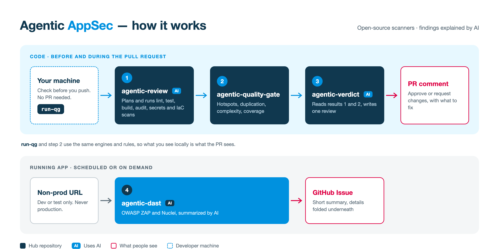
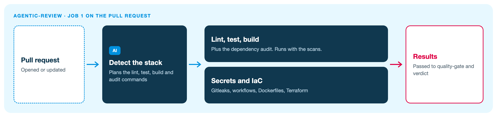

# Agentic AppSec

Four repositories that check code for Bayer teams: open-source scanners, with an AI explanation of what to fix.

## The problem

> Agentify Q&A gates for DAST and SAST checks and be part of the Agentic SDLC — contributing to an exit from SonarQube and Burp Suite. Target state: agentified SAST analysis and DAST covering bugs, vulnerabilities, code smells, coverage gaps, and duplication.

## How it works



`run-qg` on your machine and the pull-request checks use the same engines and the same rules. DAST is separate: it scans a running non-production app and never blocks a merge.

| Today | Here |
|:------|:-----|
| SonarQube | Semgrep, jscpd, Lizard and coverage in [agentic-quality-gate](#2-agentic-quality-gate), with the written review from [agentic-verdict](#3-agentic-verdict) |
| Burp Suite | OWASP ZAP and Nuclei in [agentic-dast](#4-agentic-dast), summarized by AI |

Advisory first. A team turns on failing the build after the signal is trusted. Pin every workflow to a full commit SHA before production use.

---

## 1. agentic-review

This repo. First job on a pull request. It works out the stack, then runs lint, test, build, the dependency audit, and the secret and IaC scans. Lint and scans run at the same time. It hands the results to the next two jobs and does not post the final review.



**Add it to an app.** Copy [`examples/caller-orchestrated.yml`](examples/caller-orchestrated.yml). It runs the three pull-request jobs in order:

```text
agentic-review  →  agentic-quality-gate  →  agentic-verdict
```

An optional [`.agentic-review.yml`](examples/.agentic-review.yml) in the app sets skip flags and notes for the AI, such as the package manager and where the tests live.

Secrets: `AI_API_KEY` and `AI_API_ENDPOINT`. Add `ORG_PAT` only if the hub repos are private. Skip this job with the label `skip-ai-review` or `no-review`.

## 2. agentic-quality-gate

Sonar-style checks on the change: security hotspots, secrets, duplication, complexity, and coverage. No AI in this repo.

| Where | What you get |
|:------|:-------------|
| Terminal, `run-qg` | The report, with no pull request needed |
| IDE chat, "run quality gate" | The same checks, then an explanation |
| `git push` | The same checks in a pre-push hook |
| Pull request | The same checks, plus line comments. Coverage runs here when `lcov` exists |

[Know more →](https://github.com/bayer-int/agentic-quality-gate#readme)

## 3. agentic-verdict

Last step of the pull request. It reads the results of agentic-review and agentic-quality-gate and posts one **AI Code Review**: a comment, an approve or a request for changes, and a label. It runs no scanners of its own.

[Know more →](https://github.com/bayer-int/agentic-verdict#readme)

## 4. agentic-dast

Scans a running non-production app with OWASP ZAP and Nuclei, then files one GitHub Issue: a short AI summary, with the detail folded underneath. It runs in GitHub Actions only. It does not run on a laptop, it does not scan production, and it does not block a merge.

| Profile | What it does |
|:--------|:-------------|
| `baseline` | Passive ZAP plus Nuclei. Suits a nightly run |
| `deep` | Full ZAP scan plus a wider Nuclei set |
| `api` | Same as `deep` today |

[Know more →](https://github.com/bayer-int/agentic-dast#readme)
