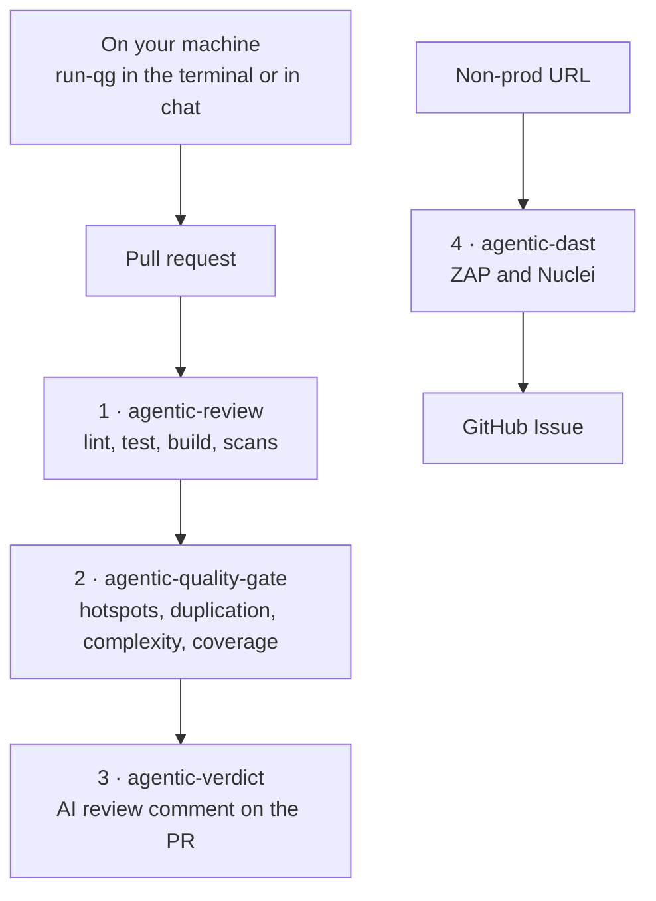
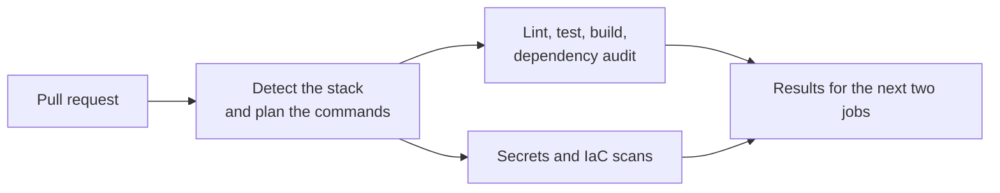

# Agentic AppSec

Four repositories that check code for Bayer teams: open-source scanners, with an AI explanation of what to fix.

**This page is the overview.** Send this link when someone asks how it works. Each repo below explains only its own job.

## The problem

> Agentify Q&A gates for DAST and SAST checks and be part of the Agentic SDLC — contributing to an exit from SonarQube and Burp Suite. Target state: agentified SAST analysis and DAST covering bugs, vulnerabilities, code smells, coverage gaps, and duplication.

## How it works



Same checks a developer runs locally with `run-qg` run again on the pull request. DAST is separate: it scans a running non-production app and never blocks a merge.

## The four repos

| | Repo | What it does |
|:-:|:-----|:-------------|
| 1 | **agentic-review** (this repo) | Looks at the pull request: stack, lint, test, build, dependency audit, secrets, IaC |
| 2 | [agentic-quality-gate](https://github.com/bayer-int/agentic-quality-gate#readme) | Sonar-style checks. Also the `run-qg` command on your machine |
| 3 | [agentic-verdict](https://github.com/bayer-int/agentic-verdict#readme) | Reads the results of 1 and 2 and posts the AI review |
| 4 | [agentic-dast](https://github.com/bayer-int/agentic-dast#readme) | Scans a live non-prod URL and files a GitHub Issue |

## What replaces SonarQube and Burp

| Today | Here |
|:------|:-----|
| SonarQube | [agentic-quality-gate](https://github.com/bayer-int/agentic-quality-gate#readme): Semgrep, jscpd, Lizard, coverage. [agentic-verdict](https://github.com/bayer-int/agentic-verdict#readme) writes the review |
| Burp Suite | [agentic-dast](https://github.com/bayer-int/agentic-dast#readme): OWASP ZAP and Nuclei, summarized by AI |

Advisory first. A team turns on failing the build after the signal is trusted. Pin every workflow to a full commit SHA before production use.

---

## This repo

Job 1. It answers: does this change build, test, and pass a security scan for its stack?



Lint, test, and scans run at the same time. The results are passed to [agentic-quality-gate](https://github.com/bayer-int/agentic-quality-gate#readme) and [agentic-verdict](https://github.com/bayer-int/agentic-verdict#readme). This repo does not post the final review.

### Add it to an app

Copy [`examples/caller-orchestrated.yml`](examples/caller-orchestrated.yml) into the app repo. It runs the three pull-request jobs in order:

```text
agentic-review  →  agentic-quality-gate  →  agentic-verdict
```

Optional [`.agentic-review.yml`](examples/.agentic-review.yml) in the app repo sets skip flags and notes for the AI (package manager, where tests live).

Secrets: `AI_API_KEY` and `AI_API_ENDPOINT`. Add `ORG_PAT` only if the hub repos are private.

Skip this job with the label `skip-ai-review` or `no-review`.
