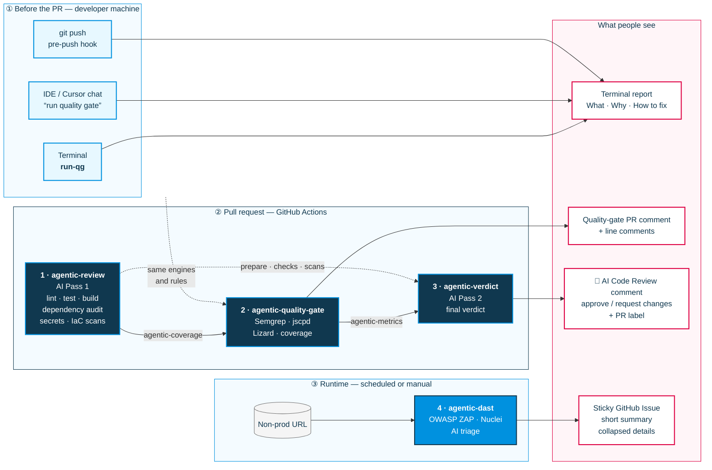
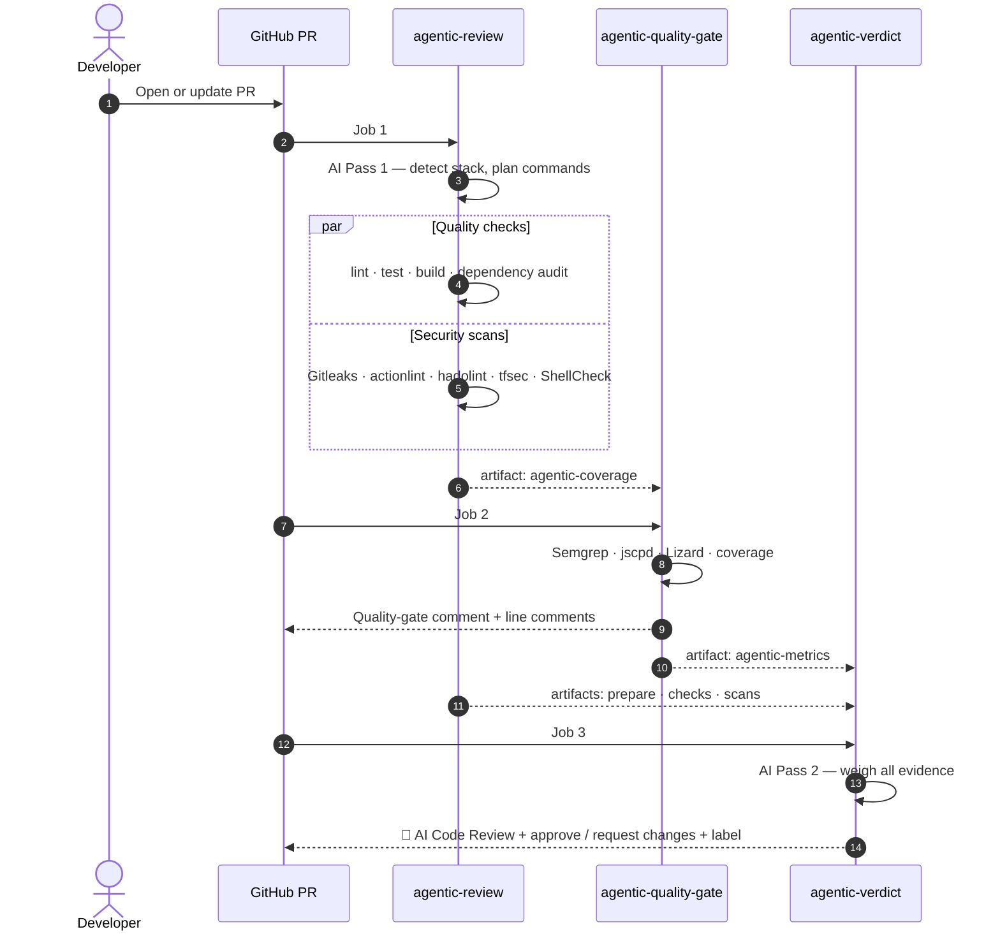

# Agentic Review

**AI pull-request review hub** — part of the **Agentic AppSec** platform: agentic SAST and DAST gates for Bayer engineering teams, built on open-source scanners and explained by AI.

This README has two halves:

1. **[Platform overview](#platform-overview)** — the problem, the four hubs, and how they fit together.
2. **[This hub: agentic-review](#this-hub-agentic-review)** — what this repo runs and how to wire it in.

---

## Platform overview

### The problem

From the QBR problem statement:

> Agentify Q&A gates for DAST and SAST checks and be part of the Agentic SDLC — contributing to an exit from SonarQube and Burp Suite. Target state: agentified SAST analysis and DAST covering bugs, vulnerabilities, code smells, coverage gaps, and duplication.

What this means in practice:

| | |
|:--|:--|
| **Who** | Developers, AppSec, QA, DevOps/Platform teams, product owners |
| **What** | SAST and DAST checks that *explain and prioritize* findings, with remediation guidance and a release-gate recommendation |
| **When** | While coding, on every PR, in CI/CD, and before release — advisory first, mandatory once validated |
| **Where** | IDE and chat, terminal, GitHub pull requests, scheduled CI against test environments |

### The four hubs

Each hub is a separate repository with a reusable GitHub Actions workflow. Application repos call the hubs; they don't copy the scripts.

| # | Hub | Role | Replaces the need for | Read more |
|:-:|:----|:-----|:----------------------|:----------|
| 1 | **agentic-review** (this repo) | AI Pass 1: detects the stack, runs lint / test / build, dependency audit, secret and IaC scans | Manual first-pass review | [README](#this-hub-agentic-review) |
| 2 | **agentic-quality-gate** | Sonar-style gate: security hotspots, secrets, duplication, complexity, coverage. Also runs locally as `run-qg` | SonarQube | [README →](https://github.com/bayer-int/agentic-quality-gate#readme) |
| 3 | **agentic-verdict** | AI Pass 2: weighs all evidence, posts the final PR review, approve / request changes, label | Reviewer triage | [README →](https://github.com/bayer-int/agentic-verdict#readme) |
| 4 | **agentic-dast** | Runtime scans of a live non-prod URL with AI triage into a sticky Issue | Burp Suite | [README →](https://github.com/bayer-int/agentic-dast#readme) |

### How it all fits together



Three entry points, one set of rules:

- **Before the PR**, developers run the quality gate locally (`run-qg` or chat) — no PR needed to see issues.
- **On the PR**, the three hubs run in order and hand evidence to each other as artifacts.
- **At runtime**, DAST runs separately on a schedule or on demand. It never targets production and is not a merge gate.

### What happens on a pull request



### Where each check runs

| Check | Local (`run-qg` / chat) | `git push` hook | Pull request | Scheduled / manual |
|:------|:-----------------------:|:---------------:|:------------:|:------------------:|
| Security hotspots and secrets (Semgrep) | ✅ | ✅ | ✅ | |
| Duplication (jscpd) | ✅ | ✅ | ✅ | |
| Complexity (Lizard) | ✅ | ✅ | ✅ | |
| Coverage on changed files | | | ✅ | |
| Lint / test / build, dependency audit | | | ✅ | |
| Secret scan (Gitleaks), workflow / Dockerfile / IaC linting | | | ✅ | |
| AI review and final verdict | | | ✅ | |
| DAST (OWASP ZAP + Nuclei) | | | | ✅ |

### Open-source tools under the hood

| Hub | Tools |
|:----|:------|
| agentic-review | Gitleaks, actionlint, hadolint, tfsec, tflint, Checkov, ShellCheck, stack-native lint / test / audit commands; Docker build + Trivy in standalone mode |
| agentic-quality-gate | Semgrep (registry packs + Bayer rules), jscpd, Lizard, lcov coverage |
| agentic-verdict | No scanners — reads artifacts from the earlier jobs |
| agentic-dast | OWASP ZAP (baseline and full scan), ProjectDiscovery Nuclei |
| All AI steps | Bayer AI endpoint via `AI_API_KEY` / `AI_API_ENDPOINT` |

### Ground rules

- **Advisory first.** The quality gate ships in `advisory` mode; teams move to `soft_fail` or `hard_fail` once they trust the signal.
- **DAST is non-prod only** and never blocks a merge.
- **Pin to a full commit SHA** for every `uses:` and `pipeline_ref` before production use.
- **Status:** piloted on real application repos. Org-wide rollout and mandatory gates are next steps, not done.

---

## This hub: agentic-review

**Job 1 of the PR pipeline.** It answers: *does this change build, test, and pass security hygiene for its stack?* — without anyone hand-writing CI commands per repo.

AI Pass 2 (the final PR comment and verdict) lives in [agentic-verdict](https://github.com/bayer-int/agentic-verdict#readme). The Sonar-style gate lives in [agentic-quality-gate](https://github.com/bayer-int/agentic-quality-gate#readme). This hub contains neither.

### What it does

| Stage | Job | What happens | Artifact |
|:-----:|:----|:-------------|:---------|
| 0 | Check skip label | Skips when the PR has `skip-ai-review` or `no-review` | — |
| 1 | Prepare context and AI Pass 1 | Reads repo config and PR diff, discovers IaC, then AI Pass 1 detects the stack (Node, Python, Go, Java, .NET, Ruby, PHP, Elixir, Terraform…) and plans lint / test / build / audit commands | `agentic-prepare` |
| 2a | Quality checks and dependency audit | Sets up the right toolchains, runs the planned commands, audits dependencies, collects coverage. If a setup command fails, the model suggests a repair and retries | `agentic-checks`, `agentic-coverage` |
| 2b | Security and hygiene scans | Gitleaks secret scan, sensitive-file checks, actionlint, hadolint, tfsec / tflint / Checkov for IaC, ShellCheck — scoped to changed files | `agentic-scans` |

Stages 2a and 2b run in parallel. Job outputs (`pr_size`, `checks_passed`, `security_exit`, …) are passed to agentic-verdict.

### Add it to an application repo

**Recommended: the orchestrated three-hub pipeline.** Copy [`examples/caller-orchestrated.yml`](examples/caller-orchestrated.yml) into `.github/workflows/` of your app repo. Its shape:

```yaml
jobs:
  ai-phase1:      # agentic-review → ai-review-phase1.yml
  quality-gate:   # agentic-quality-gate → quality-gate.yml   (needs: ai-phase1)
  ai-verdict:     # agentic-verdict → ai-verdict.yml          (needs: ai-phase1, quality-gate)
```

**Standalone mode.** [`ai-review.yml`](.github/workflows/ai-review.yml) runs Pass 1, checks, scans, optional Docker build + Trivy, and Pass 2 in a single workflow, for repos not using the full pipeline. See [`examples/caller-workflow.yml`](examples/caller-workflow.yml) and [`examples/caller-workflow-minimal.yml`](examples/caller-workflow-minimal.yml).

A monorepo example (web app + Python API + Terraform) lives in [`examples/monorepo-demo/`](examples/monorepo-demo/).

### Workflow inputs

| Input | Default | Purpose |
|:------|:--------|:--------|
| `review_type` | `full` | `full`, `security` (scans only), or `quick` (skips dependency audit) |
| `custom_instructions` | empty | Plain-English notes for the AI about your repo |
| `pipeline_repository` / `pipeline_ref` | hub repo / `main` | Where to clone the hub scripts — pin `pipeline_ref` to a full SHA |
| `ai_model` | `gpt-4.1` | LLM used for Pass 1 |
| `npm_registry_url` / `npm_scopes` | Bayer Artifactory | Private npm registry for installs |

### Per-repo configuration

Drop an optional [`.agentic-review.yml`](examples/.agentic-review.yml) in the app repo root:

```yaml
skip_docker: false
skip_security: false
skip_checks: false
max_diff_lines: 15000
custom_instructions: |
  We use pnpm. Run lint and tests from the repo root.
  The e2e folder has its own package.json.
```

Custom instructions are validated: attempts to suppress checks, force a verdict, or paste real credentials are rejected.

### Secrets

| Secret | Required | Purpose |
|:-------|:--------:|:--------|
| `AI_API_KEY`, `AI_API_ENDPOINT` | ✅ | AI Pass 1 and setup self-repair |
| `ORG_PAT` | | Clone private hub repos |
| `ARTIFACTORY_USERNAME`, `ARTIFACTORY_AUTH_TOKEN` | | Private npm / pip registries |

### Skip labels

`skip-ai-review` or `no-review` skips this hub. `skip-quality-gate` and `skip-ai-verdict` skip the other two hubs individually.

### Repository layout

```text
.github/workflows/
  ai-review-phase1.yml   # Job 1 of the orchestrated pipeline
  ai-review.yml          # Standalone end-to-end review
  hub-self-check.yml     # Syntax checks for this hub's scripts
scripts/
  gather-context.sh, discover-iac.sh, ai-pass1.sh     # context + planning
  run-checks.sh, ai-fix-setup.sh, run-dep-audit.sh    # checks + self-repair
  run-security.sh, extra-scans.sh, run-docker.sh      # scans
  collect-coverage-reports.sh                         # hand-off to quality gate
  prompts/                                            # AI system prompts
examples/                # caller workflows, config sample, monorepo demo
```
